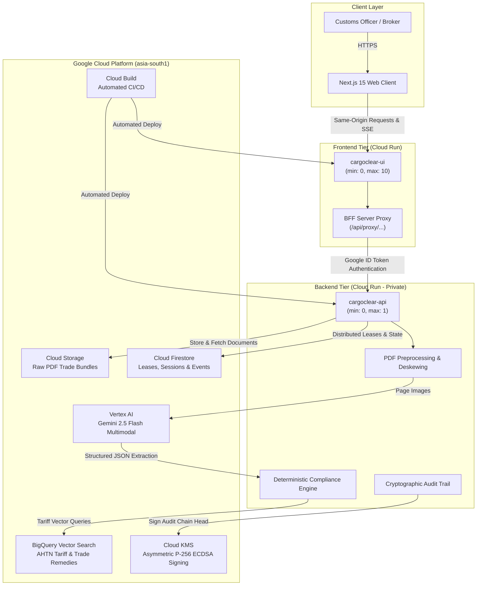

# CargoClear-JAPAC

<<<<<<< HEAD
> **Google Cloud AI Builder Cup 2026 Submission**  
> **Team:** CargoClear (`Ravi Mule`, `Nikhil Pande`)  
> **Live Web App:** [https://cargoclear-app.web.app](https://cargoclear-app.web.app) | **API:** [https://cargoclear-api-448522365737.asia-south1.run.app](https://cargoclear-api-448522365737.asia-south1.run.app)  
> **Submission Dossier:** [`submission/SUBMISSION_DOSSIER.md`](submission/SUBMISSION_DOSSIER.md) | **Submission Package:** [`submission/README.md`](submission/README.md)

CargoClear is a pre-submission, evidence-oriented customs assessment workbench for JAPAC trade bundles. It is **decision support only**: it does not submit to government portals, make legal determinations, collect or pay duty, or replace the authorised Custom House Agent. It does give an **indicative duty estimate** (an assessable value and the duties on it, with every assumption listed); that estimate is information, never an amount payable and never the assessment status.
=======
> **Pre-Submission Multimodal Customs Assessment Workbench**  
> **Google Cloud AI Builder Cup 2026 Submission** | Track: Intelligent Document Processing & Enterprise AI
>>>>>>> ffcede2 (demo recording)

[](https://cargoclear-ui-5ho4zmc74q-el.a.run.app)
[](https://cargoclear-api-5ho4zmc74q-el.a.run.app)
[-orange?logo=google-cloud)](#infrastructure--deployment)
[](LICENSE)

<<<<<<< HEAD
- **Tripartite Clearance Workbench**: Next.js 15 workbench with a 3-way layout switcher (`⊞ Split` side-by-side, `📄 Viewer` focus, `⚖️ Decision` focus), auto-hiding PDF view during analysis with automated focus scrolling to the live progress bar, SVG bounding box overlays, Reasoning Delta, and hash-verified audit chain.
- **Commercial Auth & Multi-Tenancy**: Google Workspace SSO (OAuth 2.0 / OIDC) with cryptographic RSA token validation, plus commercial user registration/sign-in backed directly by Google Cloud Firestore (`users` collection & audit subcollection) with salted PBKDF2-HMAC-SHA256 password hashing.
- **Document Staging & Classification**: Pre-upload customs document classification modal (`UploadStagingModal` portaled to document root at `z-[9999]`) enabling brokers to assign document types (`COMMERCIAL_INVOICE`, `BILL_OF_LADING`, `PACKING_LIST`, `MILL_TEST_CERTIFICATE`, `CERTIFICATE_OF_ORIGIN`) before ingestion.
- **User Profile & Appearance Management**: Interactive user profile dropdown with tenant domain badge, customs role indicator, live sign-out action, and integrated 3-way theme switcher (`Light`, `Dark`, `System`).
- **Executive KPI Dashboard**: Live landing page with real-time portfolio metrics (Compliance Rate, Flagged Contradictions, Average Assessment Latency, Indicative Duty Exposure) and direct bundle ingestion.
- **A FastAPI pipeline**: Preprocesses PDFs, extracts evidence via Vertex AI Gemini 2.5 Flash, performs deterministic checks, grounds HS requirements, and creates immutable assessment iterations.
- **Deterministic checks beyond weights and HS codes**: Invoice arithmetic (quantity × price, totals, currency), the **Mill Test Certificate against the declaration** (alloy status under HS Chapter 72 Note 1, carbon equivalent, chemistry and strength limits of the certificate's own standard, heat-number traceability to the packing list), country-of-origin consistency, and anti-dumping / circumvention flags. The rules come from curated tables in `backend/app/reference/` (labelled `demo-curated`, unverified until a reviewer says otherwise: see its README).
- **Two demo journeys**: **Case C** (India → Singapore): Invoice + Bill of Lading + Packing List give `MISSING_EVIDENCE`; adding the sample Mill Test Certificate reassesses to `COMPLIANT_FOR_SUBMISSION`. **Case D** (an import into India): all four documents are loaded and the certificate's chemistry (0.35 % chromium) contradicts the declared non-alloy HS code, giving `MATERIAL_CONTRADICTION`, an anti-dumping warning and an indicative duty estimate.
- **Corrections by the authorised agent**: Edit a value the model read in place (on any evidence row); the correction is an audited, hash-chained entry (`FIELD_CORRECTED` / `FIELD_CONFIRMED` / `CORRECTION_REVERTED`) and changes nothing until **Recompute**, which re-runs every check on the stored extraction with no document read and no model call. A reassessment keeps the corrections; the Reasoning Delta names each one, the value it replaced and the reason.
- **Declaration pre-fill pack**: The values of an assessment, with the document and page each came from, what the other documents say, what needs a person's eyes and what the declarant must still supply, as documented JSON and a printable PDF (`docs/PREFILL_PACK.md`). It says first when a bundle is not cleared and is never "ready to file"; it is not a government format.
- **Scales past one instance, safely**: Who may analyse a bundle is a Firestore lease with a fence (two instances cannot both run it; a paused executor cannot write); with `RUN_DISPATCH=cloudtasks` each run is a Cloud Task executed inside a worker request, so scale-in cannot kill it and a dead executor's run is taken over. Rate limits can be shared by all instances. Default unchanged: one always-on instance. Design: `docs/SCALING_AND_INTEGRITY.md`.
- **A signed audit trail**: After each completed assessment the head of the hash-chained audit trail is signed (Cloud KMS; a labelled throwaway key in demo mode). With a KMS key, a history rewritten consistently still fails verification (the demo key proves less and is refused where KMS is configured). Tamper-evident under the operator's key; not legal non-repudiation.
- **Better page preparation**: A sideways scan is turned (even a crooked one), an optional reversible deskew straightens skewed pages while evidence boxes still land on the original page, the model's input can be 1-bit or grayscale (an A/B is tooled), and the page image the model was shown is kept and linked ("What the model saw").
- Demo extraction is deliberately synthetic and filename-keyed. It does **not** read the sample PDFs. Live mode uses GCS, Firestore, BigQuery, and Gemini instead.
=======
---
>>>>>>> ffcede2 (demo recording)

## Executive Summary

Cross-border trade across the JAPAC (Japan, Asia-Pacific) corridor is fraught with complex regulatory hurdles. Incomplete shipping documentation, misclassified Harmonized System (HS) tariff codes, and metallurgical inconsistencies routinely trigger customs demurrage, border holds, and severe tariff penalties.

**CargoClear** is a pre-submission, evidence-grounded customs assessment workbench engineered for Custom House Agents (CHAs) and trade compliance specialists. Powered by **Google Cloud Vertex AI (Gemini 2.5 Flash)** and **BigQuery Vector Search**, CargoClear ingests multi-document trade bundles, extracts critical declarations, and deterministically audits them against international trade rules, metallurgy specs, and tariff schedules **before** formal submission.

> [!IMPORTANT]
> **Decision Support Boundary**: CargoClear is **decision support only**. It does not file directly with government portals, make legal determinations, or collect duty. It delivers verifiable evidence, highlights discrepancies, and computes **indicative duty estimates** with full assumption traceability.

---

## Live Hosted Deployments

| Component | Live Endpoint | Hosting & Region | Access Policy |
| :--- | :--- | :--- | :--- |
| **Frontend Web App** | [https://cargoclear-ui-5ho4zmc74q-el.a.run.app](https://cargoclear-ui-5ho4zmc74q-el.a.run.app) | Cloud Run (`asia-south1`) | Public (`allow-unauthenticated`) |
| **Alternative UI** | [https://cargoclear-app.web.app](https://cargoclear-app.web.app) | Firebase Hosting CDN | Public (`allow-unauthenticated`) |
| **Backend API** | `https://cargoclear-api-5ho4zmc74q-el.a.run.app` | Cloud Run (`asia-south1`) | Private (UI Service Account only via Google ID token) |

> **Scale-to-Zero Guarantee**: Both services are configured with `min-instances: 0` and active CPU throttling. When idle, container instances automatically scale to zero, maintaining **$0 idle compute cost**.

---

## Architecture & GCP Integration

CargoClear is engineered entirely on Google Cloud Platform's serverless and enterprise AI ecosystem:



### Google Cloud Technology Stack

| GCP Service | Role in CargoClear |
| :--- | :--- |
| **Vertex AI (Gemini 2.5 Flash)** | Multimodal document intelligence extracting structured fields from invoices, bills of lading, packing lists, and mill test certificates with confidence scoring. |
| **BigQuery Vector Search** | Dense semantic embedding search matching declared goods against 10,000+ AHTN (ASEAN Harmonized Tariff Nomenclature) & Indian Customs subheadings. |
| **Cloud Run** | Serverless container execution with automated scale-to-zero (`min-instances = 0`), startup CPU boost, and zero idle compute costs. |
| **Cloud Firestore** | Distributed concurrency control (atomic lease fencing) and immutable audit event persistence. |
| **Cloud Storage** | Secure, durable storage for incoming raw multi-page PDF documents. |
| **Cloud KMS** | Asymmetric cryptographic key ring (`cargoclear/audit-head`) signing audit chain heads with ECDSA P-256 SHA-256 signatures. |
| **Cloud Build** | Automated remote continuous integration and deployment pipeline across backend and frontend containers. |

---

## Key Differentiators

### 1. Multimodal Document Grounding ("What the Model Saw")
Every extracted fact is mapped back to physical page coordinates and rendered as a visual bounding box on the original document in the PDF viewer.

### 2. Deterministic Compliance Engine (Zero Hallucination)
While Gemini handles multimodal extraction, **all legal determinations and calculations are strictly deterministic**:
- **Alloy Status (HS Chapter 72 Note 1)**: Computes steel alloy qualification against international thresholds ($\text{Cr} \ge 0.30\%$, $\text{Ni} \ge 0.30\%$, $\text{Mo} \ge 0.08\%$, $\text{Mn} \ge 1.65\%$, $\text{Si} \ge 0.60\%$).
- **Carbon Equivalent Value (CEV)**: Calculates weldability index:
  $$\text{CEV} = \text{C} + \frac{\text{Mn}}{6} + \frac{\text{Cr} + \text{Mo} + \text{V}}{5} + \frac{\text{Ni} + \text{Cu}}{15}$$
- **Mechanical Strength Limits**: Validates Tensile Strength, Yield Strength, and Yield/Tensile ratio against declared ASTM/EN standards.
- **Invoice 3-Way Match**: Verifies $\text{Quantity} \times \text{Unit Price} = \text{Line Total}$ and $\text{FOB} + \text{Freight} + \text{Insurance} = \text{CIF Value}$.
- **Anti-Dumping & Circumvention**: Flags trade remedy orders matching manufacturing country vs. declared exporter.

### 3. Human-in-the-Loop Corrections with Zero-LLM Cost
When a customs specialist corrects an OCR/extraction value in-place, CargoClear recalculates all rules **instantly without re-invoking Gemini**, preventing redundant token spend and eliminating latency.

### 4. Cryptographic Tamper-Evident Audit Chain
Every operation is recorded in a SHA-256 hash-chained log ($parent\_hash = \text{SHA256}(previous\_event)$). The head of each completed iteration is signed by a Google Cloud KMS asymmetric private key.

### 5. Customs Declaration Pre-Fill Pack
Generates a verifiable customs declaration pre-fill package in both documented JSON and publication-grade printable PDF format, mapping each claim to source pages and confidence indicators.

---

## Guided Demo Walkthrough

Access the live app at [https://cargoclear-ui-5ho4zmc74q-el.a.run.app](https://cargoclear-ui-5ho4zmc74q-el.a.run.app) and sign in using Google SSO or any demo preset:

### Journey 1: Case C (India $\to$ Singapore Export — Missing Evidence)
1. Select **Start Case C demo**.
2. Run analysis on the 3 uploaded documents (Commercial Invoice, Bill of Lading, Packing List).
3. The assessment returns `MISSING_EVIDENCE` because structural steel imports require a certified Mill Test Certificate (MTC).
4. Click **Use sample MTC (demo)**. The bundle re-evaluates automatically to `COMPLIANT_FOR_SUBMISSION`.
5. Review the **Reasoning Delta** and **Audit Chain** tabs to inspect the verified cryptographic trail.

### Journey 2: Case D (India Import — Metallurgical Contradiction & Anti-Dumping)
1. Select **Start Case D demo (India import)** and click **Run analysis**.
2. All 4 documents are analyzed. The engine reports `MATERIAL_CONTRADICTION`:
   - Heat `TH-77121` reports Chromium content of **0.35%**, exceeding the 0.30% non-alloy threshold (HS Chapter 72 Note 1).
   - This contradicts the declared non-alloy HS code (`7304.19`), pointing instead to alloy subheading `7304.51`.
   - Engine triggers rule `SEC-002` (Anti-Dumping warning) and computes an **Indicative Duty Exposure** card.
3. **Interactive Agent Correction**:
   - Click **Edit** on the evidence chip `TH-77121: Cr 0.35%`.
   - Update value to `0.28%` with reason *"Lab re-test cert confirms Cr 0.28%"*.
   - Click **Save correction** and **Recompute with corrections**.
   - Rule `M-001` passes instantly with zero LLM calls; status transitions to `SPECIALIST_REVIEW_REQUIRED`.
4. Click **Download Pre-Fill Pack** to inspect the generated JSON and PDF declaration documentation.

---

## Sub-Module Documentation

Detailed architecture, code walkthroughs, and technical specifications for each tier are located in their respective subdirectories:

- 🖥️ **[Frontend UI Documentation](frontend/README.md)**: Next.js 15 App Router, BFF proxy, PDF.js canvas bounding boxes, and real-time SSE streaming.
- ⚙️ **[Backend Engine Documentation](backend/README.md)**: FastAPI clean architecture, Gemini multimodal agent, deterministic metallurgy formulas, and test suite.
- ☁️ **[Infrastructure & Deployment Documentation](infra/README.md)**: GCP serverless architecture, Cloud Run scale-to-zero, IAM security matrix, and automated scripts.

---

## Quickstart & Local Setup

### Prerequisites
- Python 3.12+
- Node.js 22+
- Git

### 1. Start Backend (Demo Mode)
```bash
cd backend
python -m venv .venv

# On Linux/macOS:
source .venv/bin/activate
# On Windows PowerShell:
.venv\Scripts\Activate.ps1

pip install -r requirements-dev.txt
APP_MODE=demo AUTH_ENABLED=true uvicorn app.main:app --host 127.0.0.1 --port 8080 --reload
```

### 2. Start Frontend
```bash
cd frontend
npm ci --legacy-peer-deps
API_BASE=http://127.0.0.1:8080 npm run dev
```
Open `http://localhost:3000` in your browser.

---

## Automated Verification & Testing

CargoClear maintains rigorous automated verification across both backend and frontend layers:

```bash
# 1. Run Backend Unit & Integration Tests (95%+ Coverage across 8,000+ statements):
cd backend
pytest tests/unit tests/integration -q

# 2. Run Deployment Contract Tests:
pytest tests/unit/test_deployment_contract.py -v

# 3. Frontend Typechecking & Linting:
cd ../frontend
npm run typecheck
npm run lint
npm run test:unit
```

---

## Deployment to GCP

- **Backend API**: `https://cargoclear-api-448522365737.asia-south1.run.app`
- **Frontend UI**: `https://cargoclear-app.web.app` (or `https://cargoclear-ui-448522365737.asia-south1.run.app`)
- **API configuration**: Deployed with `--max-instances 1`, `--min-instances 0` (scale-to-zero enabled for zero idle cost), a 300-second request timeout, and CPU startup boost.
- **UI configuration**: Runs with Next.js BFF proxy routing `/api/proxy/...` directly to the backend API, preserving same-origin semantics for both HTTP requests and SSE event streams, with dual cookie handling (`__session` and `cargoclear_session_token`) for Firebase Hosting CDN rewrites, deployed with `--min-instances 0` (scale-to-zero).
- **Live GCP Integrations**: BigQuery vector search on tariff dataset `cargoclear-hackathon:ahtn`, Firestore native database for commercial users and hash-chained audit logging, GCS PDF storage (`cargoclear-raw-pdfs`), and multimodal extraction with Vertex AI `gemini-2.5-flash`.
- **Prompt-Injection Guard**: Prompt-injection guard tested and verified across synthetic fixtures and attack variants ([docs/INJECTION_TEST.md](docs/INJECTION_TEST.md), [docs/MEASURED_RESULTS.md](docs/MEASURED_RESULTS.md)).

### Automated Remote Deployment via Cloud Build:

```bash
gcloud builds submit --config=cloudbuild.yaml --project="cargoclear-hackathon"
```

Or execute the 1-click PowerShell deployment script:

```powershell
.\infra\deploy.ps1 -ProjectId cargoclear-hackathon -Region asia-south1
```

---

## Security & Ethical AI Governance

- **Prompt-Injection Hardening**: Tested and verified against synthetic prompt-injection attacks and adversarial PDF exploits ([docs/INJECTION_TEST.md](docs/INJECTION_TEST.md)).
- **Data Residency**: All compute (Cloud Run), storage (GCS), vector search (BigQuery), and cryptographic keys (Cloud KMS) reside in `asia-south1` (Mumbai).
- **Zero Anonymous Invocation**: The backend API rejects unauthenticated traffic; only authenticated UI identities holding `roles/run.invoker` can reach internal endpoints.
- **Token Budget Protection**: Daily token limits (`DAILY_TOKEN_BUDGET`) fail closed to prevent accidental runaway inference costs.

---

## Hackathon Team & Acknowledgements

Developed for the **Google Cloud AI Builder Cup 2026**. Special thanks to Google Cloud for providing Vertex AI, BigQuery Vector Search, and Cloud Run serverless infrastructure.
