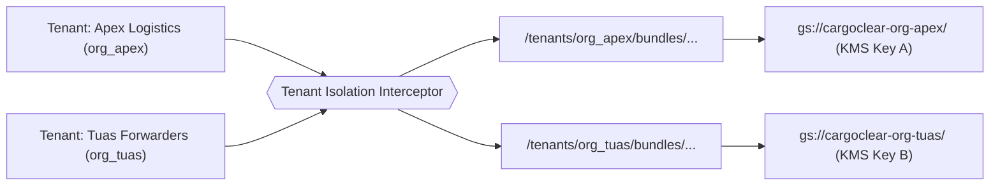
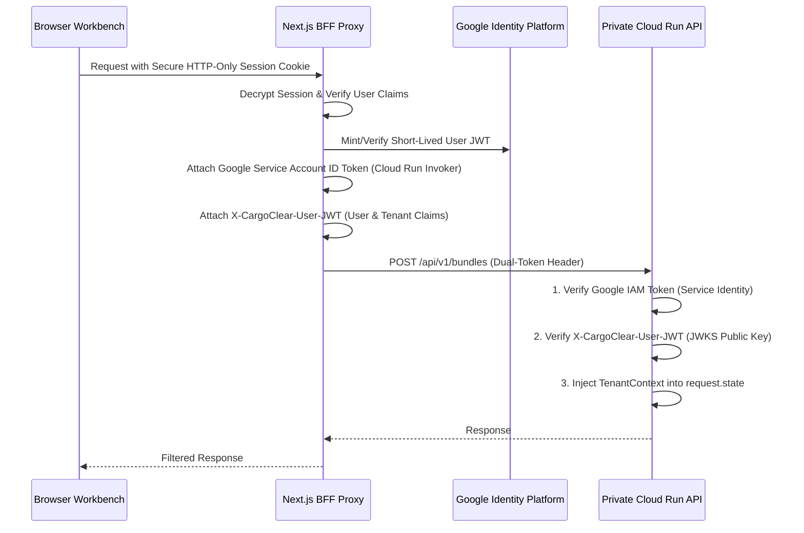
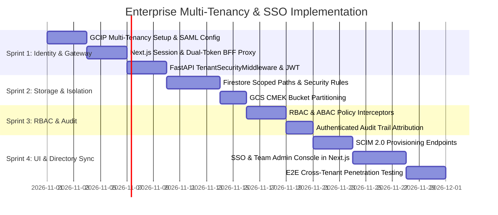

# Enterprise Multi-Tenancy & Single Sign-On (SSO) Implementation Plan

**Target System:** [`CargoClear-JAPAC`](file:///C:/Users/703292978/.gemini/antigravity/worktrees/cargoclear/cargoclear_hackathon_judge_critique/Product.md)  
**Document Version:** 1.0  
**Status:** Approved for Engineering Implementation  
**Compliance Standards:** SOC 2 Type II, ISO 27001, India MeitY Cloud Data Residency, Singapore MAS Technology Risk Management (TRM)

---

## 1. Executive Summary & Problem Statement

Currently, CargoClear operates in a **zero-tenancy, unauthenticated state**:
- As disclosed in [`CLAIMS.md`](file:///C:/Users/703292978/.gemini/antigravity/worktrees/cargoclear/cargoclear_hackathon_judge_critique/docs/CLAIMS.md) (C-52), bundles reside in a flat global namespace (`/bundles/{bundle_id}`), accessible to anyone holding the random URL.
- The audit trail actor is hardcoded as the literal string `"user"` ([`services/audit.py`](file:///C:/Users/703292978/.gemini/antigravity/worktrees/cargoclear/cargoclear_hackathon_judge_critique/backend/app/services/audit.py)), lacking individual culpability or legal non-repudiation.
- Sensitive commercial invoices, pricing data, supplier identities, and bills of lading share identical infrastructure without cryptographic or logical isolation.

This implementation plan delivers a production-grade **Hierarchical Multi-Tenancy Architecture** and **Enterprise SSO / SCIM Directory Integration**, transforming CargoClear into a secure, enterprise-ready platform for international freight forwarders, multinational logistics enterprises (e.g., DHL, DB Schenker, Kuehne+Nagel), and licensed Custom House Agencies.

---

## 2. Architectural Blueprint

```mermaid
flowchart TB
    subgraph ClientLayer["1. Client & Identity Layer"]
        User["Enterprise User / Broker"] --> Browser["Next.js Web Workbench"]
        IdP["Enterprise IdP (Okta / Entra ID / Google / CorpPass)"]
        Browser <-->|SAML 2.0 / OIDC| IdP
    end

    subgraph BFF_Gateway["2. BFF Next.js Proxy & Token Gateway"]
        Browser -->|Encrypted Session Cookie| BFF["Next.js BFF Proxy (/api/proxy/...)"]
        BFF -->|Mint Short-Lived User JWT| TokenExchange["Session to Claims Transformer"]
        TokenExchange -->|1. Google ID Token (Service-to-Service IAM)| CloudRunIAM["Cloud Run Private API Guard"]
        TokenExchange -->|2. X-CargoClear-User-JWT (Tenant Claims)| CloudRunIAM
    end

    subgraph BackendCore["3. FastAPI Core & RBAC Enforcement"]
        CloudRunIAM --> AuthMiddleware["TenantSecurityMiddleware"]
        AuthMiddleware --> RBACGuard["RBAC & ABAC Policy Interceptor"]
        RBACGuard --> TenantContext["Tenant Context Injection (tenant_id, org, role)"]
        TenantContext --> BundlesAPI["Bundles & Assessment Services"]
    end

    subgraph StorageIsolation["4. Cryptographic & Data Isolation"]
        BundlesAPI --> TenantFirestore[("Firestore: /tenants/{tenant_id}/bundles/...")]
        BundlesAPI --> TenantGCS[("GCS: gs://cargoclear-bundles/{tenant_id}/... (CMEK)")]
        BundlesAPI --> AuditTrail["Tenant Audit Ledger (Signed with User Attribution)"]
    end
```

---

## 3. Core Architecture Pillars

### 3.1 Hierarchical Tenancy Model

The tenancy hierarchy reflects real-world customs brokerage operations:

```text
Organization (e.g., "Apex Logistics Global")
 └── Workspace / Branch (e.g., "Nhava Sheva Sea Port Office", "Tuas Port Logistics Hub")
      ├── Users (Customs Brokers, Compliance Auditors, Data Entry Clerks)
      ├── Bundles (Shipment Declarations, Documents, Evidence)
      └── Policies (Port Restrictions, Dual-Signoff Value Limits, DSC Certificate Stores)
```

*Domain Schema:* `backend/app/domain/tenancy.py`
```python
from pydantic import BaseModel, Field
from typing import List, Optional, Literal
from datetime import datetime

class Organization(BaseModel):
    id: str  # e.g., "org_apex_logistics"
    name: str
    country: Literal["IN", "SG", "BOTH"]
    sso_enabled: bool = False
    sso_domain: Optional[str] = None  # e.g., "apexlogistics.com"
    idp_provider: Optional[Literal["OKTA", "ENTRA_ID", "GOOGLE_WORKSPACE", "CORPPASS"]] = None
    created_at: datetime = Field(default_factory=datetime.utcnow)
    cmek_key_id: Optional[str] = None  # Cloud KMS Customer-Managed Encryption Key

class Workspace(BaseModel):
    id: str  # e.g., "wsp_nhava_sheva"
    organization_id: str
    name: str
    allowed_ports: List[str]  # e.g., ["INNSA1", "INBOM4"]
    default_currency: str = "INR"

class UserPrincipal(BaseModel):
    id: str  # e.g., "usr_rajesh_kumar"
    email: str
    organization_id: str
    workspace_id: str
    first_name: str
    last_name: str
    role: Literal["ORG_ADMIN", "CUSTOMS_BROKER", "COMPLIANCE_AUDITOR", "DATA_ENTRY_CLERK", "INTEGRATION_BOT"]
    cha_license_number: Optional[str] = None
    dsc_certificate_thumbprint: Optional[str] = None
    is_active: bool = True
```

---

### 3.2 Enterprise Single Sign-On (SSO) & SCIM Directory Sync

#### Supported Authentication Protocols
1. **SAML 2.0 (Security Assertion Markup Language):** Native integration for enterprise Okta, Microsoft Entra ID (Azure AD), and PingFederate.
2. **OIDC (OpenID Connect):** Google Workspace Enterprise, AWS IAM Identity Center.
3. **National Identity PKI:** Singapore Singpass / CorpPass via MyInfo Business API.

#### Identity Brokering: Google Cloud Identity Platform (GCIP)
To minimize operational overhead while preserving sovereign GCP isolation, CargoClear utilizes **Google Cloud Identity Platform with Multi-Tenancy**:
- Each tenant maps to a dedicated GCIP `TenantId`.
- Tenants configure their own SAML 2.0 IdP metadata (Entity ID, SSO URL, X.509 signing certificate) via the CargoClear Admin Console.
- Domain-based SSO discovery: When a user enters `user@dhl.com`, the frontend automatically queries `GET /api/v1/auth/sso/lookup?domain=dhl.com` and redirects to the organization's dedicated IdP sign-in flow.

#### SCIM 2.0 (System for Cross-domain Identity Management)
Automated provisioning ensures that when a customs broker or compliance clerk is offboarded from Okta or Entra ID, their access to CargoClear is immediately revoked.
- `GET /api/scim/v2/Users`
- `POST /api/scim/v2/Users`
- `PUT /api/scim/v2/Users/{id}`
- `DELETE /api/scim/v2/Users/{id}` (Sets `is_active=False` and invalidates all active sessions).

---

### 3.3 Role-Based & Attribute-Based Access Control (RBAC & ABAC)

CargoClear enforces strict principle-of-least-privilege permissions across 5 granular roles:

| Role | Upload & View | Edit & Recompute | Affix DSC Signature | Export ICEGATE/TradeNet | Manage SSO & Billing |
|---|:---:|:---:|:---:|:---:|:---:|
| **ORG_ADMIN** | Yes | No | No | No | **Full Access** |
| **CUSTOMS_BROKER** | Yes | **Yes** | **Yes** | **Yes** | No |
| **COMPLIANCE_AUDITOR** | Yes (Read-Only) | No | No | Yes (Audit View) | No |
| **DATA_ENTRY_CLERK** | **Yes** | No | No | No | No |
| **INTEGRATION_BOT** | **Yes (API)** | Yes (API) | No | Yes (API) | No |

#### Attribute-Based Access Control (ABAC) Policies:
1. **Port Fencing Policy:** Brokers can only view and adjudicate bundles whose `port_of_loading` or `port_of_discharge` matches their assigned `workspace.allowed_ports`.
2. **High-Value Clearance Threshold:** Any declaration with an assessable CIF value exceeding $\$150,000$ (or ₹1.2 Crore) requires two independent `CUSTOMS_BROKER` reviews before ICEGATE export is unlocked.

---

### 3.4 Data & Storage Isolation

To prevent catastrophic cross-tenant data leakage:



1. **Firestore Database Isolation:**
   - Instead of the flat `/bundles/{bundle_id}` path, all documents are partitioned under:
     `/organizations/{org_id}/workspaces/{workspace_id}/bundles/{bundle_id}`
   - The database repository ([`backend/app/repo/firestore.py`](file:///C:/Users/703292978/.gemini/antigravity/worktrees/cargoclear/cargoclear_hackathon_judge_critique/backend/app/repo/firestore.py)) enforces tenant scoping on every read and write. Attempting to access a bundle outside the authenticated tenant’s path throws a hard `PermissionDeniedError (403)`.
2. **Cloud Storage (GCS) Partitioning with CMEK:**
   - Document artifacts are stored in tenant-prefixed storage URIs:
     `gs://cargoclear-bundles-{region}/{org_id}/{bundle_id}/{document_id}.pdf`
   - Enterprise tenants can supply their own Google Cloud KMS Key (CMEK) to encrypt their uploaded commercial documents at rest.

---

### 3.5 Token Flow & BFF Proxy Architecture

The Next.js Backend-For-Frontend (BFF) proxy currently strips all auth headers. We upgrade this flow to securely transmit authenticated identity to the private Cloud Run API:



#### New Header Protocol:
- `Authorization`: `Bearer <Google_ID_Token>` (Satisfies Cloud Run `--no-allow-unauthenticated` private ingress).
- `X-CargoClear-User-JWT`: Signed Ed25519 or RS256 JWT containing:
  ```json
  {
    "sub": "usr_99812",
    "email": "rajesh.kumar@apexlogistics.in",
    "org_id": "org_apex_in",
    "workspace_id": "wsp_nhava_sheva",
    "role": "CUSTOMS_BROKER",
    "cha_license": "CHA-11/2019-MUM",
    "exp": 1760443200
  }
  ```

---

### 3.6 Authenticated Audit Attribution

The audit trail ([`backend/app/services/audit.py`](file:///C:/Users/703292978/.gemini/antigravity/worktrees/cargoclear/cargoclear_hackathon_judge_critique/backend/app/services/audit.py)) replaces the hardcoded `"user"` string with the authenticated cryptographic principal:

*Audit Event Structure:*
```json
{
  "event_id": "evt-77a8b9c0d1e2",
  "bundle_id": "bnd-019283",
  "event_type": "FIELD_CORRECTED",
  "timestamp": "2026-10-14T12:30:00Z",
  "actor": {
    "user_id": "usr_rajesh_kumar",
    "email": "rajesh.kumar@apexlogistics.in",
    "organization_id": "org_apex_in",
    "workspace_id": "wsp_nhava_sheva",
    "role": "CUSTOMS_BROKER",
    "cha_license": "CHA-11/2019-MUM",
    "ip_address": "103.21.244.2",
    "session_id": "ses_998172"
  },
  "payload": {
    "field": "test_results[20].value",
    "old_value": "0.35",
    "new_value": "0.28",
    "reason": "Corrected per mill test certificate certified chemical assay."
  },
  "prev_event_hash": "a1b2c3d4...",
  "event_hash": "e5f6g7h8..."
}
```

This ensures full legal culpability under Section 146 of the Indian Customs Act and Regulation 38 of the Singapore Customs Regulations.

---

## 4. UI & Workbench Additions

1. **Organization & Workspace Switcher ([`TopBar.tsx`](file:///C:/Users/703292978/.gemini/antigravity/worktrees/cargoclear/cargoclear_hackathon_judge_critique/frontend/components/shell/TopBar.tsx)):**
   - Renders active organization name, branch workspace, and user role pill (`[Apex Logistics | Nhava Sheva Sea Port]`).
2. **Enterprise SSO Admin Settings (`/settings/sso`):**
   - Self-service portal for Org Admins to upload SAML 2.0 XML metadata, configure Assertion Consumer Service (ACS) URLs, and enforce 2FA.
3. **Team & Member Management (`/settings/team`):**
   - Invite brokers, configure CHA license numbers, view registered DSC USB token serials, and toggle active user status.

---

## 5. Implementation Sprints & Roadmap



### Detailed Sprints:

#### Sprint 1: Identity Brokering & Dual-Token Gateway (Days 1–9)
- **Tasks:**
  - Configure Google Cloud Identity Platform with multi-tenant mode enabled.
  - Upgrade `frontend/lib/server/proxy.ts` to decode Next.js session cookies and attach `X-CargoClear-User-JWT`.
  - Add `backend/app/gateway/auth.py` with FastAPI dependency `get_current_principal()`.
- **Exit Gate:** Unauthenticated calls to `/api/v1/bundles` return `401 Unauthorized`; valid user tokens inject `TenantContext`.

#### Sprint 2: Multi-Tenant Data Isolation (Days 10–15)
- **Tasks:**
  - Refactor `backend/app/repo/firestore.py` to route all queries through `/organizations/{org_id}/...`.
  - Update `backend/app/repo/leases.py` to enforce lease isolation per tenant.
  - Implement GCS directory partitioning with per-tenant CMEK key management.
- **Exit Gate:** Automated penetration test: Tenant B attempts to read `bnd-case-d` created by Tenant A; backend returns `404 Not Found` / `403 Forbidden`.

#### Sprint 3: RBAC, ABAC & Authenticated Audit Ledger (Days 16–20)
- **Tasks:**
  - Implement role decorators: `@require_role(["CUSTOMS_BROKER", "ORG_ADMIN"])`.
  - Enforce port-code ABAC filters on bundle listings.
  - Upgrade `services/audit.py` to record full authenticated user actor schemas.
- **Exit Gate:** A user with role `DATA_ENTRY_CLERK` attempting to trigger `/recompute` or `/export/icegate` receives `403 Forbidden`.

#### Sprint 4: SCIM 2.0 & Admin Management UI (Days 21–30)
- **Tasks:**
  - Add SCIM 2.0 endpoints for Okta/Azure AD automated lifecycle management.
  - Build `/settings/sso` and `/settings/team` Next.js frontend pages.
  - Conduct full SOC 2 Type II readiness review and cross-tenant leakage fuzz testing.
- **Exit Gate:** Automated Okta SCIM sync provisions and de-provisions users; Org Admin successfully completes SAML SSO setup.

---

## 6. Backwards Compatibility & Developer Experience

To ensure developers and local hackathon evaluators can continue testing without an active Okta or GCP Identity account:
- In `APP_MODE=demo` or `ENV=local`, the auth middleware automatically injects a default Mock Principal:
  ```json
  {
    "user_id": "usr_local_dev",
    "email": "dev@cargoclear.local",
    "organization_id": "org_demo",
    "workspace_id": "wsp_default",
    "role": "CUSTOMS_BROKER",
    "cha_license": "CHA-DEMO-001"
  }
  ```
- In `APP_MODE=live`, `ENFORCE_AUTH=true` is strictly required; any missing token triggers an immediate `401 Unauthorized` response.

---
*(Technical plan created and saved to [docs/ENTERPRISE_MULTI_TENANCY_AND_SSO_PLAN.md](file:///C:/Users/703292978/.gemini/antigravity/worktrees/cargoclear/cargoclear_hackathon_judge_critique/docs/ENTERPRISE_MULTI_TENANCY_AND_SSO_PLAN.md).)*
