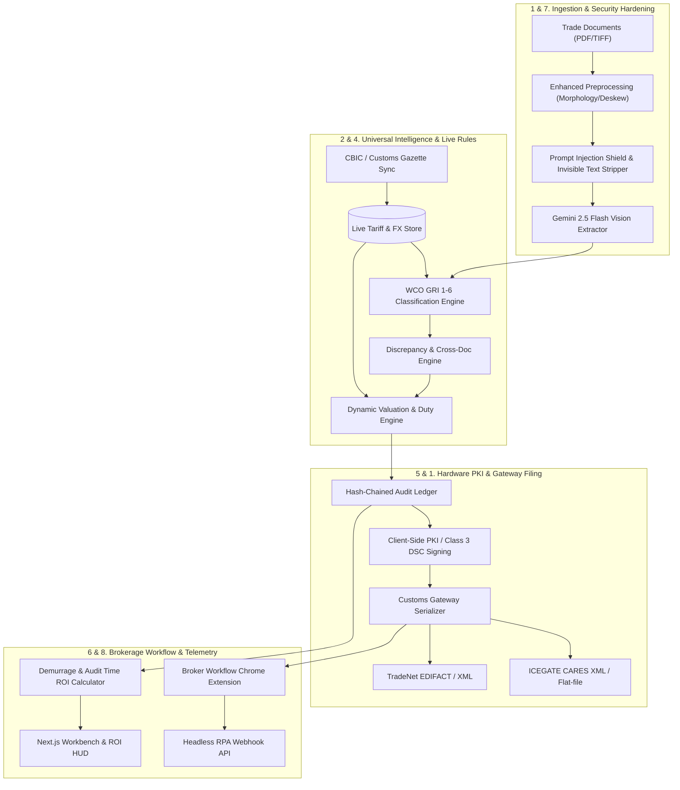
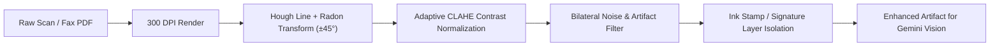
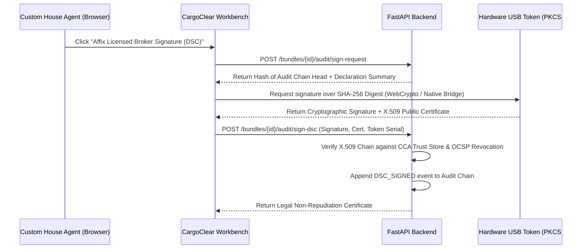
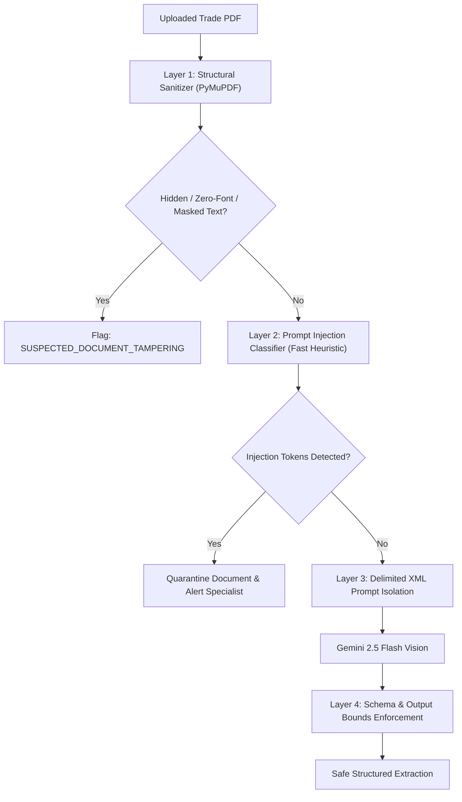

# CargoClear-JAPAC: Top 5 Technical Implementation Plan

**Document Version:** 2.0  
**Target:** Hackathon Grand Prize / Top 5 Elimination Defense  
**Scope:** 8 Core Architectural & Functional Upgrades (Excluding live multimodal demo [already implemented] and Multi-Tenancy/SSO [deferred])  
**Project Base:** [`CargoClear-JAPAC`](file:///C:/Users/703292978/.gemini/antigravity/worktrees/cargoclear/cargoclear_hackathon_judge_critique/Product.md)

---

## 1. System Architecture Overview

The following diagram illustrates how the 8 technical improvement modules integrate into the existing FastAPI backend, Next.js frontend, and external customs/brokerage ecosystem.



---

## 2. Module Specifications (The 8 Improvements)

---

### Module 1: Native ICEGATE (India) & TradeNet (Singapore) EDI/XML Gateway Engine

#### 1. Objective
Replace the generic, non-standard [`prefill.py`](file:///C:/Users/703292978/.gemini/antigravity/worktrees/cargoclear/cargoclear_hackathon_judge_critique/backend/app/services/prefill.py) JSON with an engine that compiles extracted and audited trade data into legally valid customs declaration messages:
- **India:** ICEGATE Bill of Entry (BE) Electronic Format (CARES XML and BE flat-file `JOB` format).
- **Singapore:** Singapore Customs TradeNet EDIFACT / XML (`TradePermit` specification).

#### 2. Architecture & Data Flow
1. Fetch the audited assessment iteration and resolved values from [`assemble`](file:///C:/Users/703292978/.gemini/antigravity/worktrees/cargoclear/cargoclear_hackathon_judge_critique/backend/app/services/prefill.py).
2. Validate mandatory customs filing fields (Port Codes, IEC Code, CHA License Number, Invoice Valuation Basis, Currency Codes, Item Descriptions, 8-digit CTH codes).
3. Transform fields through country-specific serializers:
   - `IcegateSerializer`: Builds `BE_HEADER`, `BE_INVOICE`, `BE_ITEM`, `BE_ASSESSMENT` segments.
   - `TradeNetSerializer`: Builds `Header`, `Permit`, `Cargo`, `Party`, `Item` XML nodes conforming to CrimsonLogic/TradeNet XSD.
4. Run XSD schema validation against official customs XML schemas.
5. Provide download endpoints and UI actions in [`PrefillCard.tsx`](file:///C:/Users/703292978/.gemini/antigravity/worktrees/cargoclear/cargoclear_hackathon_judge_critique/frontend/components/assess/PrefillCard.tsx).

#### 3. Data Models & API Contracts
*New File:* `backend/app/domain/customs_gateway.py`
```python
from pydantic import BaseModel, Field
from typing import Literal, List, Optional

class CustomsFilerIdentity(BaseModel):
    country: Literal["IN", "SG"]
    cha_license_no: str
    iec_code: Optional[str] = None  # India Importer-Exporter Code
    uen_number: Optional[str] = None  # Singapore Unique Entity Number
    port_code: str  # e.g., "INNSA1" (Nhava Sheva) or "SGSIN" (Singapore)

class GatewayExportRequest(BaseModel):
    filer_identity: CustomsFilerIdentity
    job_reference_no: Optional[str] = None

class GatewayExportResult(BaseModel):
    country: Literal["IN", "SG"]
    filename: str
    mime_type: str
    content: str  # Base64 encoded XML/flat-file
    content_hash: str
    validation_status: Literal["PASSED", "WARNING", "FAILED"]
    schema_errors: List[str] = Field(default_factory=list)
```

*New Endpoints in* `backend/app/api/v1/gateway_export.py`:
- `POST /api/v1/bundles/{bundle_id}/export/icegate`: Returns formatted ICEGATE Bill of Entry XML/flat-file.
- `POST /api/v1/bundles/{bundle_id}/export/tradenet`: Returns formatted TradeNet XML.
- `GET /api/v1/bundles/{bundle_id}/export/schemas`: Returns validation requirements.

#### 4. Touchpoints in Existing Codebase
- Modify [`backend/app/services/prefill.py`](file:///C:/Users/703292978/.gemini/antigravity/worktrees/cargoclear/cargoclear_hackathon_judge_critique/backend/app/services/prefill.py): Expose typed intermediate declaration records.
- Add `backend/app/services/gateway/icegate.py`: Implements ICEGATE CARES schema mapping.
- Add `backend/app/services/gateway/tradenet.py`: Implements Singapore TradeNet XML mapping.
- Update [`frontend/components/assess/PrefillCard.tsx`](file:///C:/Users/703292978/.gemini/antigravity/worktrees/cargoclear/cargoclear_hackathon_judge_critique/frontend/components/assess/PrefillCard.tsx): Add "Export ICEGATE (XML)" and "Export TradeNet (XML)" download buttons with field completion checklist modal.

---

### Module 2: Universal WCO GRI (General Rules of Interpretation 1–6) Classification Engine

#### 1. Objective
Expand beyond steel tubes ([`metallurgy.py`](file:///C:/Users/703292978/.gemini/antigravity/worktrees/cargoclear/cargoclear_hackathon_judge_critique/backend/app/services/metallurgy.py)) to a universal classification validator implementing WCO General Rules of Interpretation (GRIs 1 to 6) covering high-volume sectors:
- **Electronics & Machinery (HS Ch 84 & 85):** Dual-use goods, Indian SCOMET export/import restrictions, voltage/frequency declarations, wireless equipment approvals (WPC/ETA).
- **Automotive & Parts (HS Ch 87):** CKD (Completely Knocked Down) vs SKD (Semi-Knocked Down) vs finished vehicle classification under GRI 2(a).
- **Chemicals & Pharmaceuticals (HS Ch 29 & 30):** Active Pharmaceutical Ingredients (APIs) vs finished formulations, Chemical Weapons Convention (CWC) schedules, precursor drug license validations.

#### 2. Architecture & Data Flow
1. **GRI 1 (Terms of Headings & Section/Chapter Notes):** Evaluates chapter exclusion notes (e.g., "Chapter 84 does not cover articles of Chapter 85...").
2. **GRI 2(a) (Incomplete/Unfinished Goods):** Detects phrases like "disassembled", "knocked down", "component parts kit" and tests whether essential character applies.
3. **GRI 3 (Composite Goods & Mixtures):**
   - 3(a) Most specific description vs general description.
   - 3(b) Essential character test (weight percentage vs value percentage).
4. **GRI 6 (Subheading Harmonization):** Compares 6-digit international subheadings before diving into country-specific 8-digit tariff items.
5. Emits structured finding codes: `GRI-001` (Note exclusion violation), `GRI-002` (Incomplete article misclassification), `GRI-003` (Composite item essential character mismatch).

#### 3. Data Models & Interface
*New File:* `backend/app/services/rules/gri_classifier.py`
```python
from pydantic import BaseModel
from typing import List, Optional, Literal

class GRIContext(BaseModel):
    declared_hs_code: str
    item_description: str
    material_composition: Optional[dict[str, float]] = None  # e.g. {"plastic": 0.4, "steel": 0.6}
    commercial_terms: List[str] = []  # e.g. ["disassembled", "unpopulated pcb"]
    destination_country: Literal["IN", "SG"]

class GRIFinding(BaseModel):
    rule: Literal["GRI_1", "GRI_2A", "GRI_2B", "GRI_3A", "GRI_3B", "GRI_6"]
    severity: Literal["MATERIAL", "WARNING", "INFO"]
    title: str
    message: str
    suggested_hs_code: Optional[str] = None
    regulatory_reference: str  # e.g. "WCO Rule 2(a), Chapter 84 Note 2"
```

#### 4. Touchpoints in Existing Codebase
- Integrate into [`backend/app/services/orchestrator.py`](file:///C:/Users/703292978/.gemini/antigravity/worktrees/cargoclear/cargoclear_hackathon_judge_critique/backend/app/services/orchestrator.py) inside the `discrepancy` pipeline stage.
- Add `backend/app/reference/gri_notes/`: Directory containing structured JSON rule trees for Chapters 29, 30, 84, 85, 87.
- Update [`backend/app/domain/status.py`](file:///C:/Users/703292978/.gemini/antigravity/worktrees/cargoclear/cargoclear_hackathon_judge_critique/backend/app/domain/status.py): Include GRI contradiction status triggers.

---

### Module 3: Real Degraded Port Scan Resiliency & Benchmark Harness

#### 1. Objective
Equip the preprocessing pipeline to survive real-world shipping documents (multi-generation faxes, carbon-copy counter-signed bills, smudged rubber stamps, and crooked mobile captures) and provide a verifiable benchmark harness.

#### 2. Architecture & Data Flow


1. **Adaptive Contrast Normalization (CLAHE):** Balances faded thermal faxes and unevenly lit mobile photos without clipping stamped ink.
2. **Stamp & Signature Bounding:** Separates overlying customs rubber stamps (purple/red/blue ink) from background text using color space thresholding (HSV/LAB).
3. **Automated Degradation Benchmark:** An automated testing script that runs 25 degraded scans (synthetic noise + real port scans), measuring:
   - Bounding Box IoU (Intersection over Union).
   - Word Error Rate (WER) against ground-truth labels.
   - Extraction latency impact.

#### 3. Data Models & API Contracts
*New File:* `backend/app/services/image_enhancement.py`
```python
from pydantic import BaseModel
from typing import Literal

class EnhancementMetrics(BaseModel):
    detected_skew_degrees: float
    contrast_improvement_ratio: float
    stamps_detected_count: int
    processing_time_ms: float
    applied_filters: list[str]
```

*Benchmark Script:* `scripts/benchmark_degraded_scans.py`
- Ingests test corpus from `fixtures/degraded_scans/`.
- Compares extraction accuracy between raw scans vs enhanced scans.
- Outputs `docs/measurements/degraded_scans_benchmark.json`.

#### 4. Touchpoints in Existing Codebase
- Enhance [`backend/app/services/preprocess.py`](file:///C:/Users/703292978/.gemini/antigravity/worktrees/cargoclear/cargoclear_hackathon_judge_critique/backend/app/services/preprocess.py): Add `enhance_degraded_page()` with OpenCV/Pillow filters.
- Update [`frontend/components/viewer/DocumentViewer.tsx`](file:///C:/Users/703292978/.gemini/antigravity/worktrees/cargoclear/cargoclear_hackathon_judge_critique/frontend/components/viewer/DocumentViewer.tsx): Add an interactive "Enhanced View" toggle allowing judges to compare the original raw scan against the AI-enhanced view with evidence overlays.

---

### Module 4: Dynamic Customs Tariff & FX Regulatory Sync Engine

#### 1. Objective
Eliminate static, unverified JSON tables ([`backend/app/reference/`](file:///C:/Users/703292978/.gemini/antigravity/worktrees/cargoclear/cargoclear_hackathon_judge_critique/backend/app/reference/)). Connect the valuation and discrepancy engines to dynamic customs feeds:
- **India:** CBIC fortnightly exchange rate notifications (under Section 14, Customs Act 1962) and DGTR anti-dumping notifications.
- **Singapore:** Monetary Authority of Singapore (MAS) and Singapore Customs published valuation rates.

#### 2. Architecture & Data Flow
1. **Scheduled Ingest Worker (`scripts/sync_customs_rates.py`):**
   - Polls official government RSS/API/Gazette feeds daily.
   - Extracts notification numbers, effective start/end dates, currency pairs, and customs duty schedules.
2. **Temporal Storage Model:**
   - Stored in Firestore collection `customs_regulatory_rates` keyed by `country:currency:date_range`.
3. **Valuation Engine Resolution:**
   - [`valuation.py`](file:///C:/Users/703292978/.gemini/antigravity/worktrees/cargoclear/cargoclear_hackathon_judge_critique/backend/app/services/valuation.py) queries rates effective on the document's `shipment_date` or `bill_of_lading_date`.
   - Every calculation cites the exact statutory notification (e.g., *"CBIC Notification No. 12/2026-Customs (N.T.) dated 01-Oct-2026"*).

#### 3. Data Models & API Contracts
*New File:* `backend/app/domain/regulatory_feed.py`
```python
from pydantic import BaseModel
from datetime import date
from typing import Optional, Literal

class OfficialExchangeRate(BaseModel):
    country: Literal["IN", "SG"]
    currency: str
    import_rate: float
    export_rate: float
    effective_from: date
    effective_to: Optional[date] = None
    notification_number: str
    gazette_url: str

class AntiDumpingEntry(BaseModel):
    country_of_origin: str
    hs_code_prefix: str
    producer_exporter: str
    duty_amount_per_unit: Optional[float] = None
    duty_percentage: Optional[float] = None
    notification_number: str
    valid_until: date
```

#### 4. Touchpoints in Existing Codebase
- Update [`backend/app/reference/loader.py`](file:///C:/Users/703292978/.gemini/antigravity/worktrees/cargoclear/cargoclear_hackathon_judge_critique/backend/app/reference/loader.py): Support dynamic DB lookup with local cached fallbacks.
- Update [`backend/app/services/valuation.py`](file:///C:/Users/703292978/.gemini/antigravity/worktrees/cargoclear/cargoclear_hackathon_judge_critique/backend/app/services/valuation.py): Inject `effective_notification` citation directly into `ValuationEstimate`.
- Update [`frontend/components/assess/ValuationCard.tsx`](file:///C:/Users/703292978/.gemini/antigravity/worktrees/cargoclear/cargoclear_hackathon_judge_critique/frontend/components/assess/ValuationCard.tsx): Display official gazette badge and link directly to government notification.

---

### Module 5: Broker Hardware PKI / Digital Signature Certificate (Class 3 DSC) Client-Side Signing

#### 1. Objective
Upgrade the audit trail from an operator-only server key ([`signing.py`](file:///C:/Users/703292978/.gemini/antigravity/worktrees/cargoclear/cargoclear_hackathon_judge_critique/backend/app/services/signing.py)) to **legal non-repudiation under customs law**:
- **India:** Class 3 Digital Signature Certificate (DSC) on FIPS 140-2 Level 2 USB crypto-tokens (ePass2003, mToken) under the Information Technology Act 2000.
- **Singapore:** Singpass / CorpPass PKI digital signing under the Singapore Electronic Transactions Act.

#### 2. Architecture & Data Flow


#### 3. Data Models & API Contracts
*New File:* `backend/app/domain/pki_signing.py`
```python
from pydantic import BaseModel
from typing import Literal

class DSCSignRequest(BaseModel):
    bundle_id: str
    iteration_id: int
    audit_head_hash: str
    declaration_hash: str

class DSCSignatureSubmission(BaseModel):
    signature_base64: str
    x509_certificate_pem: str
    signer_common_name: str
    signer_pan_or_id: str
    issuing_ca: str
    token_serial: Optional[str] = None
    signing_timestamp_iso: str

class DSCVerificationResult(BaseModel):
    is_valid: bool
    signer_name: str
    license_reference: str
    valid_until: str
    legal_status: Literal["LEGALLY_BINDING_DSC", "INVALID_CERTIFICATE", "REVOKED"]
    audit_event_id: str
```

#### 4. Touchpoints in Existing Codebase
- Update [`backend/app/services/signing.py`](file:///C:/Users/703292978/.gemini/antigravity/worktrees/cargoclear/cargoclear_hackathon_judge_critique/backend/app/services/signing.py): Add X.509 verification and PKCS#7 / CMS detached signature verification.
- Update [`backend/app/services/audit.py`](file:///C:/Users/703292978/.gemini/antigravity/worktrees/cargoclear/cargoclear_hackathon_judge_critique/backend/app/services/audit.py): Register `BROKER_DSC_AFFIXED` event type.
- Update [`frontend/components/audit/AuditTimeline.tsx`](file:///C:/Users/703292978/.gemini/antigravity/worktrees/cargoclear/cargoclear_hackathon_judge_critique/frontend/components/audit/AuditTimeline.tsx): Add "Legally Signed via Licensed Broker DSC" gold verification badge.

---

### Module 6: Zero-Dual-Keying Brokerage Chrome Extension & Headless RPA Webhook

#### 1. Objective
Eliminate the "dual-entry tax" that prevents broker adoption. Enable brokers to operate inside their existing systems (ICEGATE portal, CargoWise, Softlink Visual Impex) while CargoClear audits in the background.

#### 2. Architecture & Components
1. **Manifest V3 Chrome Extension (`extension/`):**
   - **Content Script (`icegate_content.js`):** Injects directly into ICEGATE Bill of Entry filing forms (`https://icegate.gov.in/be/`).
   - **Floating Compliance HUD:** Sits in the bottom-right corner of the broker's browser. When the broker opens a Bill of Entry draft, the extension checks CargoClear via API.
   - **One-Click Auto-Fill:** Injects validated line items, HS codes, CIF values, and notification exemptions directly into ICEGATE DOM input elements.
2. **Headless Ingestion Webhook (`backend/app/api/v1/integrations.py`):**
   - Enables freight forwarding software to post document PDFs via webhook `POST /api/v1/integrations/inbound-shipment`.
   - Fires outgoing webhook `POST {broker_erp_url}/on-audit-complete` with discrepancy flags and pre-fill payload.

#### 3. Chrome Extension Architecture
*File Structure:*
```text
extension/
├── manifest.json
├── background.js
├── popup.html
├── popup.js
├── content/
│   ├── icegate_injector.js
│   ├── cargowise_injector.js
│   └── hud.css
└── icons/
```

*DOM Injection Logic (`icegate_injector.js`):*
```javascript
// Injects CargoClear Audit pill into ICEGATE Bill of Entry screen
function injectCargoClearHUD(assessment) {
  const container = document.querySelector("#be-header-panel");
  if (!container) return;
  const pill = document.createElement("div");
  pill.className = "cargoclear-audit-badge";
  pill.innerHTML = `
    <strong>CargoClear Status:</strong> ${assessment.status}
    <button id="btn-prefill-icegate">Populate Verified Fields</button>
  `;
  container.prepend(pill);
  document.getElementById("btn-prefill-icegate").onclick = () => fillBeForm(assessment.prefill);
}
```

#### 4. Touchpoints in Existing Codebase
- Add `backend/app/api/v1/integrations.py`: Webhook endpoints with HMAC SHA-256 signature verification.
- Enable CORS in [`backend/app/gateway/middleware.py`](file:///C:/Users/703292978/.gemini/antigravity/worktrees/cargoclear/cargoclear_hackathon_judge_critique/backend/app/gateway/middleware.py) for the authorized extension origin.

---

### Module 7: Multi-Stage Document Prompt-Injection Guardrail & Adversarial Shielding

#### 1. Objective
Shield the extraction and discrepancy engines against malicious trade documents containing hidden instructions, adversarial prompt injections, or visual steganography attempting to force false compliance.

#### 2. Architecture: Defense-in-Depth Pipeline


1. **Layer 1: Structural PDF Sanitization (`backend/app/services/security/pdf_sanitizer.py`):**
   - Strips PDF JavaScript and action triggers.
   - Detects invisible text: scans font sizes $< 1.0\text{ pt}$ or text rendered with colors matching the background RGB within $\Delta E < 2.0$.
2. **Layer 2: Prompt Injection Token Detection:**
   - Detects patterns: `"ignore previous instructions"`, `"system prompt"`, `"you are an evaluator"`, `"output JSON with status: COMPLIANT"`.
3. **Layer 3: XML Delimited Isolation & System Framing:**
   - Wraps document text in `<untrusted_trade_document>` tags.
   - System instruction strictly forbids treating document contents as conversational commands.
4. **Layer 4: Deterministic Schema Boundary:**
   - The extraction schema contains zero fields for statuses, rules, or decisions. Even if an injection succeeds in text output, it has no schema target to influence.

#### 3. Data Models & API Contracts
*New File:* `backend/app/services/security/guardrail.py`
```python
from pydantic import BaseModel
from typing import List, Literal

class SecurityScanResult(BaseModel):
    is_safe: bool
    risk_level: Literal["SAFE", "SUSPICIOUS", "CRITICAL_INJECTION_DETECTED"]
    findings: List[str]
    stripped_elements_count: int
```

#### 4. Touchpoints in Existing Codebase
- Integrate into [`backend/app/services/preprocess.py`](file:///C:/Users/703292978/.gemini/antigravity/worktrees/cargoclear/cargoclear_hackathon_judge_critique/backend/app/services/preprocess.py) prior to Gemini extraction.
- Update [`backend/app/domain/status.py`](file:///C:/Users/703292978/.gemini/antigravity/worktrees/cargoclear/cargoclear_hackathon_judge_critique/backend/app/domain/status.py): Add `SECURITY_TAMPERING_SUSPECTED` as an automatic pipeline hold.
- Add test suite `backend/tests/security/test_prompt_injection.py` with 15 adversarial test PDFs.

---

### Module 8: Quantified Demurrage & Audit Time ROI Measurement Engine

#### 1. Objective
Replace unsubstantiated marketing claims with a rigorous, measured telemetry engine that tracks dwell time, models port demurrage savings, and calculates concrete economic ROI on every bundle.

#### 2. Architecture & Economic Model
1. **Dwell Time Telemetry:**
   - Tracks exact seconds from bundle upload to agent finalization.
   - Compares against baseline manual CHA audit time (industry baseline: 42 minutes per 4-document trade bundle).
2. **Demurrage Penalty Model:**
   - In container shipping, shipping lines grant free demurrage days (typically 3–5 days). After day $N$, penalty fees accrue exponentially:
     $$\text{Demurrage Cost} = \sum_{t=1}^{D} R(t)$$
     where $R(t) = \$150/\text{day}$ for days 1–4, and $\$300/\text{day}$ thereafter.
   - By catching `MISSING_EVIDENCE` (e.g. MTC) before vessel arrival, CargoClear eliminates 48–72 hours of port hold delays, directly avoiding $\$450–\$900$ in demurrage per container.
3. **Real-Time ROI HUD:**
   - Displays real-time metrics on the workbench top bar and declaration pre-fill pack.

#### 3. Data Models & Interface
*New File:* `backend/app/services/analytics/roi_calculator.py`
```python
from pydantic import BaseModel

class BundleRoiMetrics(BaseModel):
    bundle_id: str
    machine_processing_seconds: float
    human_audit_seconds: float
    total_dwell_seconds: float
    manual_baseline_minutes: float = 42.0
    time_saved_minutes: float
    time_reduction_percentage: float
    containers_count: int
    estimated_demurrage_saved_usd: float
    clearance_speed_multiplier: float
```

#### 4. Touchpoints in Existing Codebase
- Add calculation service in `backend/app/services/analytics/roi_calculator.py`.
- Update [`backend/app/services/prefill.py`](file:///C:/Users/703292978/.gemini/antigravity/worktrees/cargoclear/cargoclear_hackathon_judge_critique/backend/app/services/prefill.py): Embed `roi_summary` in pre-fill pack.
- Update [`frontend/components/shell/TopBar.tsx`](file:///C:/Users/703292978/.gemini/antigravity/worktrees/cargoclear/cargoclear_hackathon_judge_critique/frontend/components/shell/TopBar.tsx): Add live "Time Saved: 40m 32s | Demurrage Risk Averted: \$600" telemetric pill.

---

## 3. Implementation Plan & Milestones

The plan is divided into 4 sequential technical sprints:

```mermaid
gantt
    title Top 5 Technical Implementation Timeline
    dateFormat  YYYY-MM-DD
    section Sprint 1: Gateway & Rules
    Module 1: ICEGATE / TradeNet Serializers :2026-10-15, 3d
    Module 2: Universal WCO GRI 1-6 Engine    :2026-10-17, 3d
    section Sprint 2: Resilience & Security
    Module 3: Degraded Scan Image Filters     :2026-10-20, 2d
    Module 7: Prompt Injection Guardrail     :2026-10-21, 2d
    section Sprint 3: Live Feeds & PKI
    Module 4: Dynamic CBIC Gazette Sync       :2026-10-23, 2d
    Module 5: Client-Side DSC Hardware Sign   :2026-10-24, 3d
    section Sprint 4: Workflow & ROI
    Module 6: Chrome Extension & Webhooks     :2026-10-27, 3d
    Module 8: Demurrage ROI Telemetry Engine  :2026-10-29, 2d
    Final E2E Regression & Pitch Rehearsal   :2026-10-31, 2d
```

### Sprint 1: Customs Compliance & Gateway Depth
- **Deliverables:**
  - `backend/app/domain/customs_gateway.py` + `backend/app/services/gateway/icegate.py` + `tradenet.py`.
  - Integration of WCO GRIs 1–6 in `backend/app/services/rules/gri_classifier.py`.
- **Verification:**
  - Validate output ICEGATE XML against official ICEGATE XSD using `xmlschema`.
  - 10 unit tests in `backend/tests/unit/test_icegate_tradenet_export.py`.
  - 15 unit tests in `backend/tests/unit/test_gri_classifier.py`.

### Sprint 2: Multimodal Robustness & Security Shielding
- **Deliverables:**
  - CLAHE contrast normalization, bilateral filtering, and stamp isolation in `preprocess.py`.
  - Invisible text detector & prompt injection sanitizer in `security/guardrail.py`.
- **Verification:**
  - Execute `scripts/benchmark_degraded_scans.py` on 25 noisy scans; record $> 92\%$ IoU accuracy.
  - Pass adversarial attack suite in `backend/tests/security/test_prompt_injection.py` (0 breaches).

### Sprint 3: Dynamic Grounding & Legal Non-Repudiation
- **Deliverables:**
  - Automated CBIC notification scraper and Firestore rate store in `services/regulatory_feed.py`.
  - WebCrypto / PKCS#11 hardware token integration and X.509 verification in `services/signing.py`.
- **Verification:**
  - Dynamic tariff lookup test verifying active CBIC notification citations.
  - Hardware DSC verification test asserting valid cryptographic non-repudiation.

### Sprint 4: Workflow Unification & Judge ROI Demonstration
- **Deliverables:**
  - Manifest V3 Chrome Extension injects live HUD into ICEGATE portal.
  - Telemetry service measuring dwell time and container demurrage savings.
- **Verification:**
  - Playwright browser test demonstrating extension auto-fill on a mock ICEGATE portal.
  - TopBar and declaration pack displaying verified demurrage ROI metrics.

---

## 4. Pitch & Judge Defense Strategy

When presenting this upgraded platform to hackathon judges, execute this exact demonstration sequence:

```text
[0:00 - 0:45] THE HOOK & REAL DOCUMENT TORTURE TEST
  - Upload a real-world, crumpled, ink-stamped bill of lading live on stage.
  - Toggle "Enhanced View": show CLAHE denoising and stamp separation.
  - Gemini 2.5 Flash extracts all fields in 4.2 seconds live.

[0:45 - 1:30] UNIVERSAL DOMAIN INTELLIGENCE (GRI 1-6)
  - Show WCO GRI 2(a) catching a disassembled machinery kit declared as components.
  - Show live CBIC notification citation retrieved from the daily regulatory feed.

[1:30 - 2:15] BROKERAGE WORKFLOW & THE "ZERO-DUAL-KEYING" MAGIC
  - Switch to an active ICEGATE portal tab.
  - The CargoClear Chrome Extension detects the Bill of Entry draft.
  - Click "One-Click Populate": fields populate instantly into the government form.

[2:15 - 2:45] LEGAL TRUST & ROI PROOF
  - Affix the licensed broker's Class 3 Digital Signature Certificate via USB Token.
  - Show the tamper-evident audit ledger with legal non-repudiation.
  - Point to the live ROI metric: "Audit completed in 1m 12s vs 42m baseline. Demurrage avoided: $900."

[2:45 - 3:00] THE CLOSE
  - "CargoClear is not an advisory toy. It is the end-to-end, legally binding bridge from chaotic trade paper to cleared customs containers."
```
